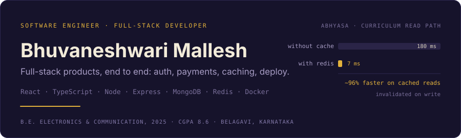
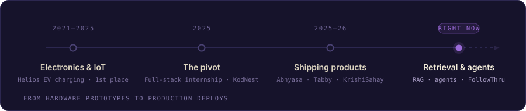

Electronics and communication engineer by degree, full-stack developer by choice. I build
products end to end — React and TypeScript on the front, Node and Express behind it, and
the parts most side projects skip: cache invalidation, token rotation, payment webhooks,
multi-stage Docker builds. Going deeper on retrieval and agent systems now, and writing
down what breaks as I build it.

## How I got here

Four years of electronics gave me the habit of assuming a system will fail and designing for
what happens next. **Helios**, my final-year wireless EV charging project, took 1st place at
the college project exhibition; before that I built an automatic door with fire-sensor safety
interlocks. In 2025 I moved into software through a paid full-stack development internship
at KodNest. Everything since has been shipping real things end to end.

## Stack

| | |
| --- | --- |
| **Languages** |      |
| **Frontend** |     |
| **Backend** |     |
| **Databases** |     |
| **Tools** |      |

Badges marked **learning** are exactly that — in progress, not production experience.

## Featured work

### Abhyasa &nbsp;·&nbsp; EdTech platform
**Sole engineer** &nbsp;·&nbsp; 2025–2026 &nbsp;·&nbsp; Belagavi (remote)

**Stack** — React · TypeScript · Node · Express · MongoDB · Redis · Razorpay · Docker

A MERN learning platform for Indian school curricula, with paid subscriptions. I designed,
built and deployed all of it.

- **Caching.** Redis in-memory caching with invalidation on write across the read-heavy
  curriculum routes. Cut API latency by roughly 96% — about 180 ms down to about 7 ms.
- **Payments.** Razorpay on two channels: a dynamic UPI Bharat QR with 15-minute TTL polling,
  and the standard Checkout Modal. Subscriptions are provisioned by webhook, and every
  callback goes through signature verification before it's trusted.
- **Auth.** JWT access/refresh token rotation in httpOnly secure cookies, multi-role RBAC
  separating students from admins, and rate limiting behind the reverse proxy.
- **Delivery.** Multi-stage Docker build running as a non-root user, plus a TypeScript
  integration test suite — 12 core API routes, 100% passing.
- **What actually broke.** CORS preflight failures between the decoupled frontend and the
  Render backend. Deployments that kept failing until I standardised the build commands.
  And 30–50 second free-tier cold starts, which I handled with loading skeletons and retuned
  client timeouts instead of pretending they weren't there.

### Tabby &nbsp;·&nbsp; Bill splitting
**72-hour sprint** &nbsp;·&nbsp; Lovable SheBuilds Season 4

**Stack** — React · TypeScript · Tailwind CSS · Supabase Edge Functions

Takes a tangle of group IOUs and reduces it to the fewest direct payments. Built in 72 hours
for SheBuilds Season 4, a women-only global buildathon that drew 5,000+ applicants from
100+ countries.

- **The algorithm.** Debt minimisation collapses who-owes-whom into the smallest set of
  transfers. All money is handled in integer minor units, so there's no float drift to
  explain away later.
- **Performance.** Nested state effects were looping and freezing the main thread —
  fixed with memoisation. A separate layout shift traced back to inconsistent grid
  constraints, unified into one.
- **Features.** UPI deep links, WhatsApp nudge messages with a tone picker, and basic
  receipt upload with OCR.
- **What's next, stated plainly.** There's no persistent backend yet — sessions are
  ephemeral and there's no group history. That's the next build, not a gap I'm hiding.

### KrishiSahay &nbsp;·&nbsp; Agricultural advisory

A prototype advisory platform for small-scale farmers in India: spectral crop advisories,
crop disease diagnosis through Gemini Vision, mandi price lookup, and a voice assistant for
hands-free use in the field. A working demo rather than a product — it hasn't been put in
front of real farmers yet.

## 🚧 Right now — FollowThru

**In active development. Not finished, not deployed.**

A job-application tracker built for how people actually apply now: from phone apps like
LinkedIn, Indeed, Naukri, Hirist and Cutshort, most of which never send a confirmation
email. Every tracker I found assumes a clean desktop-and-inbox trail that doesn't exist
anymore.

- **Capture by screenshot.** Gemini Vision reads the company, role and date off a
  screenshot. Android share-sheet integration comes later.
- **A real agent pipeline.** LangGraph handles extract → dedupe-match against existing
  applications → decide whether a follow-up reminder is warranted, as genuine conditional
  routing rather than one prompt call wearing an agent costume. I'm building it this way
  because I shipped a hackathon "agent" once that was deterministic if-else underneath,
  and I'd rather do it properly.
- **Grounded resume matching.** Gap suggestions are retrieved from a Postgres + pgvector
  store of my own real resume bullets, so what comes back is something I've actually done
  rather than something the model invented.
- **Design direction.** Clean and modern-professional, with personality in the micro-copy
  and one deliberate accent colour — not another purple-gradient AI tool.

**Stack** — Python · FastAPI · Gemini · LangChain/LangGraph · Postgres + pgvector (Supabase)

## Achievements

| | |
| --- | --- |
| **GSSoC 2025** | Open-source contributor, GirlScript Summer of Code. |
| **Lovable SheBuilds S4** | Selected for the Season 4 buildathon, October 2026. |
| **Helios** | 1st place, college project exhibition — wireless EV charging system. |
| **LeetCode** | [100+ problems solved](https://leetcode.com/u/bhuvnaaa/). |
| **IEEE Student Chapter, SDIT** | Secretary and founding officer, 2024–25. Owned chapter administration and documentation, co-organised workshops. |
| **Annual College Fest** | Technical Coordinator, ECE branch, 2024–25. |

## Off the clock

| | |
| --- | --- |
| &nbsp; **Film, closely** | I can't just watch a scene, I have to know why it worked. Same reason I don't ship a fix until I know what actually broke. |
| &nbsp; **Dostoevsky, Kafka** | I'll sit with a slow book longer than I probably should. Also true of bugs — I've burned a whole evening on one that turned out to be a missing `await`. |
| &nbsp; **Singing, competitively** | No retakes, no undo button. Closest thing to deploying on a Friday. |
| &nbsp; **Rabbit holes** | I'll lose an evening to a question I have no practical use for, usually because the standard explanation doesn't quite hold up. Same instinct as not trusting a claim until I've checked it against more than one source — which is more or less what retrieval does for FollowThru's resume matching. |
| &nbsp; **Cooking** | I ignore the recipe and fix it by taste. Same as most of my debugging, honestly — guess, taste, adjust, repeat. |
| &nbsp; **One Piece, Ghibli** | Fine with a slow build if the ending's earned. Good thing, given how many times this project list has changed. |
| &nbsp; **Journaling, cloud photos** | I write down ordinary days for the same reason I log what broke in a deploy — not every entry needs to be impressive to be worth keeping. |

## GitHub

## Get in touch

Open to software engineering and full-stack roles.

Belagavi, Karnataka, India.
